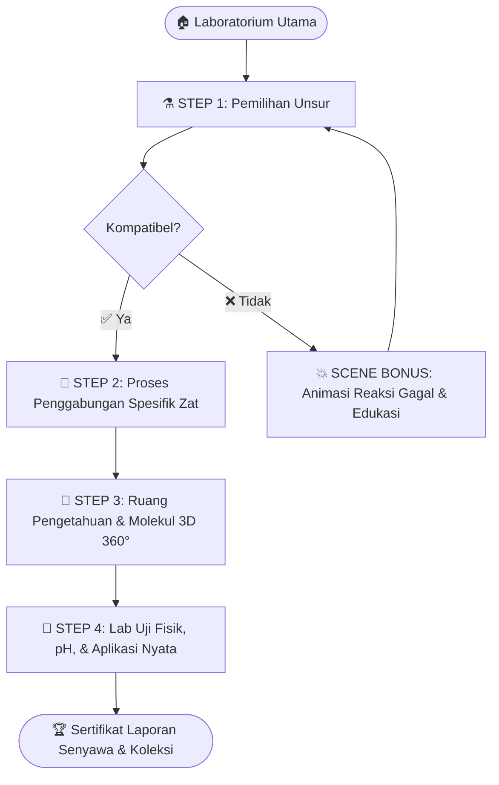

# chembond-game
Game Edukasi Kimia Interaktif, buat murid mu paham materi kimia lewat game
# 🧪 ChemBond: The Chemical Fusion Game
> **Belajar Kimia Sambil Bermain — Gabungkan Unsur, Temukan Keajaiban!**  
> *Interactive Educational Chemistry Simulation & Game Prototype*

---

## 💡 Tentang Proyek Ini
**ChemBond** adalah purwarupa (*prototype*) aplikasi web pembelajaran kimia interaktif yang dirancang untuk mengubah cara siswa memahami reaksi kimia. Alih-alih menghafal rumus di atas kertas, pemain diajak masuk ke dalam laboratorium virtual untuk memilih unsur dari Tabel Periodik, mengalami langsung proses pembentukan ikatan kimia, mengamati struktur molekul 3D, hingga menguji sifat fisik dan reaktivitas senyawa yang dihasilkan.

---

## 🧠 Peran Saya & Metodologi Pengembangan (*My Role & Workflow*)

Proyek ini dikembangkan menggunakan pendekatan **AI-Assisted Rapid Prototyping**. Dalam proyek ini, saya berperan penuh sebagai:

* **🎯 Concept Creator & Product Designer:** Merancang visi produk, menyusun struktur *Product Requirements Document (PRD)*, dan mendesain siklus pembelajaran 4 tahap (*4-Step Learning Loop*) agar materi kimia tetap seru tanpa kehilangan esensi akademisnya.
* **🔬 Game System & Logic Director:** Mengarahkan logika permainan dan melakukan evaluasi kritis terhadap mekanisme kimia di dalam aplikasi. 
  * *Studi Kasus Iterasi Desain:* Pada versi awal, proses penggabungan zat hanya menggunakan 4 mini-game generik. Saya melakukan revisi arsitektur permainan pada **Step 2** agar **setiap senyawa memiliki mekanisme penggabungan unik yang mencerminkan sifat kimia aslinya** (misalnya: pemindahan elektron untuk ikatan ionik `NaCl`, kontrol suhu & tekanan tinggi untuk proses *Haber-Bosch* pada `NH₃`, serta titrasi buret untuk `HCl`).
* **⚡ Iterative Prompt Engineer:** Mengarahkan AI untuk menerjemahkan spesifikasi desain, antarmuka pengguna (UI/UX), dan logika simulasi ke dalam arsitektur kode *Single-File HTML5* (HTML, CSS, dan Vanilla JavaScript) melalui rangkaian *prompting* terstruktur dan pengujian bertahap.

---

## 🔄 Arsitektur Gameplay (4-Step Learning Loop)

Setiap reaksi kimia di dalam **ChemBond** melewati 4 tahapan berurutan, ditambah *Scene Bonus* edukatif jika pemain menggabungkan dua unsur yang tidak kompatibel:

---

## 🔬 8 Mekanisme Penggabungan Spesifik (Fitur Unggulan Step 2)

Berbeda dari kuis kimia biasa, **ChemBond** mensimulasikan cara penggabungan yang berbeda-beda tergantung karakteristik senyawa yang dibuat:

| Reaksi Senyawa | Metode Penggabungan di Game | Konsep Kimia yang Dipelajari |
|---|---|---|
| **H₂O (Air)** | 🧲 *Orbital Electron Pairing* | Pemasangan elektron kovalen & sudut bengkok 104.5° akibat tolakan PEB |
| **NaCl (Garam Dapur)** | 💎 *Ionic Transfer & Lattice Builder* | Pelepasan 1 elektron valensi Na ke Cl dilanjutkan penyusunan kisi kristal 3x3 |
| **CO₂ (Karbon Dioksida)** | 🔥 *Combustion Rhythm Ignition* | Penjagaan suhu pembakaran sempurna (700°C–850°C) agar bebas jelaga CO |
| **HCl (Asam Klorida)** | 🌀 *Titration & Magnetic Stirrer* | Pencampuran larutan terukur menggunakan buret hingga mencapai titik ekuivalen |
| **FeS (Besi Sulfida)** | 🌋 *Bunsen Burner Smelting* | Pemanasan serbuk padat besi dan belerang hingga mencapai titik lebur reaksi |
| **NH₃ (Amonia)** | ⚙️ *Haber-Bosch Reactor Control* | Penyetelan kesetimbangan suhu (~450°C), tekanan (~200 atm), dan katalis Besi (Fe) |
| **SiO₂ (Pasir Kuarsa)** | 🏗️ *Silica Network Polymerization* | Perangkaian ikatan kovalen raksasa berulang (`-Si-O-Si-O-`) |
| **CaO (Kapur Tohor)** | ⚡ *Calcination Energy Circuit* | Penyusunan jalur sirkuit energi termal untuk memicu reaksi oksidasi kalsium |

---

## 🛠️ Fitur Lain di Dalam Purwarupa
* **Tabel Periodik Interaktif:** Dilengkapi filter golongan unsur, kartu spektrum konfigurasi elektron, dan sistem *Preview* kompatibilitas ikatan.
* **Scene Bonus Reaksi Gagal:** Menggabungkan gas mulia (`He + Ne`), sesama logam reaktif (`Na + K`), atau gas berbahaya (`Cl + N`) memicu animasi visual tanpa menghukum pemain.
* **Visualisasi Molekul 3D 360°:** Menggunakan *HTML5 Canvas* yang bisa diputar dengan *mouse* atau sentuhan layar, lengkap dengan mode *Ball-and-Stick* dan *Space-Fill*.
* **Laboratorium Pengujian (Step 4):** Pengujian titik leleh/didih menggunakan *slider* suhu, uji konduktivitas lampu LED, uji indikator pH, hingga penerbitan **Laporan Senyawa** resmi.

---

## 🚀 Cara Menjalankan Secara Lokal
1. Unduh file `index.html` dari *repository* ini.
2. Klik dua kali file `index.html` untuk membukanya langsung di browser modern apa pun (Chrome, Edge, Firefox, Safari) tanpa perlu instalasi server tambahan.
kalau di android : https://rid1710.github.io/chembond-game/
